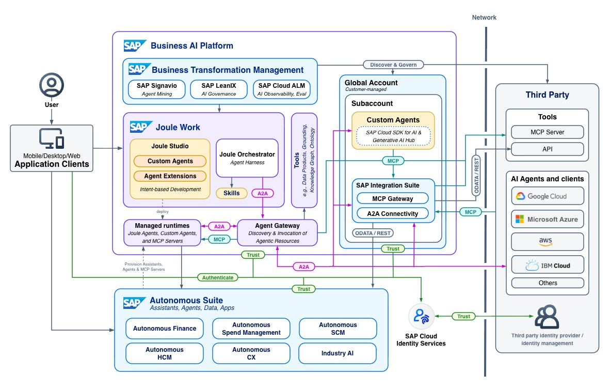

# Joule A2A: From Customer-Managed to SAP-Managed — Options for BTP Code-Based Agents

Many customers used the option to connect custom-built pro-code agents on BTP to (Customer-Managed) Joule. Now, with the re-launch of Joule and Joule Studio, there are a few things to consider moving forward. In this blog post I describe the paths forward for custom-built, BTP-based agents in the new landscape of the Business AI platform.

For the bigger picture, everything here sits within the frame set by the SAP reference architecture [A2A and MCP for AI Agent Interoperability at SAP](https://architecture.learning.sap.com/docs/ref-arch/76ec36) — that is the authoritative view of how A2A and MCP fit together across SAP and third-party systems, and it is worth reading before diving into the options below.

This post is for developers who already run a custom BTP agent (Python, CAP, or otherwise) connected to Joule — and especially for those who followed my earlier series on wiring pro-code agents to the (then customer-managed) Joule via A2A. That series started with [Joule A2A: Connect Code-Based Agents into Joule](https://community.sap.com/t5/technology-blog-posts-by-sap/joule-a2a-connect-code-based-agents-into-joule/ba-p/14329279) and built up through authentication with IAS, multi-turn conversations, async communications to principal propagation into S/4HANA.

> **Note:** This is the state of November 2026

## So what changed?

### CMJ to SMJ

At the core, the most significant change is the evolution from Joule 1.0 — what is called Customer-Managed Joule (CMJ) — to **Joule Work**, which can be considered a 2.0 version and is now "SAP-managed" (SMJ).

This managed approach means a few things. In the past, Joule mainly surfaced as a BTP service. You subscribed to it, set up formations and destinations in your subaccounts to connect it to systems, and had to integrate it with other components like Joule Studio, Work Zone, or Document Grounding.

A key change now is that Joule Work is not really a BTP service anymore. The way Joule surfaces to customers is via a provisioning flow in SAP for Me — and with it come a number of changes. Since the provisioning flow in SAP for Me now does a lot of the integration and setup work for you, once a solution is provisioned a bunch of tenants are spun up in the background and the system connections are there out of the box.

### Changes in extensibility

With this new Joule, the extensibility options have been reworked as well. Previously, we had the option to pursue a low-code path in the now-called "classic" Joule Studio — to create skills and agents, both of which were quite constrained. In addition, we had the option to pursue a pro-code-based approach by creating capabilities — essentially YAML-based descriptors of functionality — that also exposed skills or agents. In that pro-code YAML approach, we could register an A2A agent via an agent connector (what this series is about). Skills were hard-wired, deterministic sequences of conditions and API calls.

Now, in the new world, Joule Studio 2.0 has been launched. It mainly introduces changes on two axes:

- The **design time** is now driven by interacting with a coding agent.
- The **runtime** is a Kubernetes-based custom-resource environment that gives us artifact-specific benefits.

We create Agents, n8n workflows, and agent extensions in Joule Studio 2.0 (and much more coming).

In our context, the agent is the relevant artifact for now. How does it look in practice: The coding agent creates a set of Python files to build an A2A-capable agent based on a very familiar LangChain pattern. These agents use MCP tools via an out-of-the-box system connectivity path supporting principal propagation. The managed agent runtime — in which the Python code is deployed — handles authentication out of the box, and the integration into Joule is taken care of via registration through the agent gateway and IAS. Once deployed and the roles are assigned to users, the agents are consumable via Joule.

If you built along with the series, this matters: the IAS setup and the principal-propagation chain are now handled by the runtime. The work you put into wiring IAS trust and SAML bearer flows is exactly what you no longer need to do here. But at the same time this also comes with some restraints: Currently in Joule Studio 2.0 this automatic integration towards the APIs does not work for all kinds of APIs. For example take an API that does not support principal propagation. In the past that meant you implemented your own way of guarding that access for your app - in Joule Studio, only APIs where the principal propagation can be enforced from the beginning are accessible. 

## Where does my existing agent go?

There are essentially three paths forward for existing BTP agent developments. Here is the quick decision overview before we go into detail:

| Path | Available today? | When it fits | Main limitation |
|------|------------------|--------------|-----------------|
| **Migrate to Joule Studio 2.0** | ✅ Yes | New or re-buildable cases; you want PP & auth out of the box | Only connects to systems in your SMJ formation (third-party MCP on roadmap) |
| **Outbound A2A to Joule Work** | ⏳ Not yet (roadmap) | You want to keep the existing BTP agent as-is | Not supported yet; protocol/connection details still to come |
| **Joule skills (Markdown)** | ✅ Yes | Simple cases that only need orchestration + connected-system data | No custom code; relies on the orchestrator's agentic reasoning |

Beyond these three, there is a transitional option: you can import existing CMJ capability YAMLs into the new setup. This carries existing investments across short-term but has limited future for new topics — see SAP's [Transitioning from Customer-Managed Joule](https://help.sap.com/docs/joule-work/services/transitioning-from-customer-managed-joule) guidance. More on this below.

Now let's walk through each of these.

## Migrate an A2A agent to Joule Studio

Here I want to discuss the options and considerations if you are not starting on a green field. Since you already have an agent — maybe written in Python, maybe based on CAP, maybe even in another programming language, and certainly carrying a little complexity — there are a few things to think about.

### 1. Adapt to Joule Studio's connectivity options

First and foremost, Joule Studio supports connectivity to the connected systems from your SMJ setup. This means if you connected SMJ to S/4HANA Public Cloud, you can get the coding agent to set you up an MCP server that will talk to the OData APIs available in that system. No need for creating own Destination and Communication Scenarios or API Users. This is super convenient because it comes with principal propagation out of the box. So whenever you have the option, such a managed integration is the way to go and a big leap forward in comparison how we ran extensions in BTP for the past decade! 

Note: As mentioned above this does come with some restrictions on the API availability - the APIs need to be enabled for Principal Propagation - and for some LoBs like Ariba - that excludes a larger number of them because they were never meant to be used for Agents at the time when they were created many years ago.

**Integrating with systems not in the SMJ formation**

More interesting is what is *not* (yet, as of 9 Nov) possible: connecting any third-party system. If you are pulling data from an on-prem or BW system — which cannot be connected to Joule — then this is a blocker right now. E.g. simple Agents like my Currency Agent using a Third-Party API are affected.

Note: There is a roadmap item to support third-party MCP servers that will cover this

In Joule Studio, MCP is the protocol to expose data to agents. Maybe you implemented tools in the past based on Python functions that did individual API calls — this is a pattern that will not be that easily possible anymore.

This means that right now the described pattern, including the Integration Suite MCP Gateway, is the cleanest way to connect to other data sources after all — because it can translate OData nicely into MCP, and we can then register that with the new agent. The topic of Cloud Connector is also something we would then handle at that point, in the Integration Suite subaccount.

You can use MCP Gateway already today in full form - checkout my other post on that. 

### 2. Change in Discovery and Registration of Agents

The YAML markup model we have seen in the CMJ A2A setup is now gone with Joule Studio 2.0. That means Agents are directly hooked up to the Orchestrator and the intermediary deterministic "Joule Function" logic does not exist anymore. A fixed set of fields are passed to the A2A Agent at runtime - so multi-turn handling etc. are there out of the box. In the past we took care of that ourselves.

But with the going away of the YAMLs, also a large part of flexibility in scripting UI elements is now gone.

### 3. Ways of interacting

In the old CMJ world, via the YAMLs, we were able to configure some nice modals — this is not really the standard anymore. Instead, Markdown is the main form of communication. So your agent should adapt to Markdown as the communication default. Message in, message out. The orchestrator will format or parse information from the Agent in subsequent processes.

### 4. Managed Runtime

While the old BTP based Agents were usually deployed on Cloud Foundry. With the new Joule Studio the Agent is deployed on a kubernetes based environment that is managed by SAP. While Cloud Foundry gives you a lot of control about the environment, scaling etc. with Joule Studio you are mainly running within the constraints of that custom resource definition. The artefacts are grouped in "Solutions" and you will end up with a deployment descriptor called solution.yaml that can contain multiple dependent assets. For example you might have a project including some MCP Servers and a Custom Agent.

Action Items for Migration:

- Instead of own connectivity paths consider using a Joule Studio built (/translated) MCP server to connect to Systems
- For any third party connectivity be prepared to use an MCP Server - checkout MCP Gateway as an Option
- Make sure your agent does not rely on custom modals from YAML and rework in Markdown
- Adapt to use the Managed Runtime from BAIP - that means no own Destination and Auth out of the box + adapt deployment descriptor to asset.yaml
- Maintain the Agent Card properly - this is now really used for routing from the orchestration
- Think of the Agent Identity as a new concept to IAM with Agents

For a concrete example on the approach I will consider writing another detailed blog. In short: The best approach right now is to use the Pro-Code Flow from Joule Studio via the jl command line. This gives you enough flexibility to start with an existing project structure and then have a coding agent guide you along the way to adapting to the new structure.

## Connect an agent via A2A to Joule Work

The second obvious choice would be to again use A2A — keep the BTP agent as is — and try hooking it up to Joule Work. This is the path that preserves the most of your existing series investment. This is something we call *outbound A2A*, and it is currently not yet supported and part of a future roadmap. Here, most likely, the way of connecting will not involve the YAML madness anymore. 

For this topic I will follow up with another post once it is possible.

## A third way: Joule skills

With Joule Work - also the new Agentic Thinking orchestration mode has been announced. It is much more versatile and can be extended with Skills: Markdown-based prompts in combination with scripts that can infuse intelligence and know-how into the main orchestration agent's agentic thinking. Users can select these skills at runtime, and with them you can help the orchestrator perform tasks, given its out-of-the-box ability to retrieve data from the connected systems. Though be aware of the restrictions. While Skills in Joule Work Desktop can even install full-on python packages, the environment in the web has some limitations. Also regarding connecting to arbitrary systems from a skill using curl for example.

But anyhow - So many super-simple use cases that in the past were an agent use case might have shifted — with the new possibilities of agentic thinking. So definitely give this one a try.

## Choose an Approach

To conclude: there are several options and paths forward for custom agents. The new Joule Studio presents a way to build things super quickly, implementing key enterprise requirements like principal propagation and authentication out of the box — things that earlier took days to figure out. Large Agent Systems with plenty of custom connectivity and scaling - might be better off staying on a customer managed BTP Account and opting for integration options via upcoming A2A. New features like Skills in Agentic Thinking are improving the agentic experience with very low effort.

Each of the approaches has its advantages. If starting today - using the new Joule Studio is certainly a convenient way to get started. For existing agents, you can choose between the approaches. Both are currently imperfect — but that is usually the case with change. 

I hope this helps you navigate the landscape a bit better. Let me know in case of further questions. And refer to previous posts for more Context on Connecting BTP Code-Based Agents to Joule.
