# Joule A2A: MCP Gateway to S/4HANA with Principal Propagation

In a [previous post](https://community.sap.com/t5/technology-blog-posts-by-sap/joule-a2a-propagate-the-user-identity-from-joule-into-s-4hana/ba-p/14420290) we looked at connecting a custom A2A agent to S/4HANA Public Cloud with full principal propagation. But that approach comes with some drawbacks: hooking up individual APIs doesn't scale well, and it's hard to enforce governance. The Model Context Protocol (MCP) is an open standard for exposing tools and data to AI agents in a uniform way, and it's quickly becoming the common language between agents and enterprise systems. SAP's [reference architecture for Agents and MCP](https://architecture.learning.sap.com/docs/ref-arch/76ec36) positions Integration Suite as an MCP Gateway to safeguard traffic to enterprise systems — so this post extends the example to route a BTP-based agent through that gateway, still from customer-managed Joule.

> **Note:** This post covers Customer-Managed Joule.

## Scenario

We have an A2A-capable agent connected to Joule (customer-managed), with a destination that hands the Joule user's token to the agent on each A2A request. To reach S/4HANA Public Cloud, that agent now goes through the **MCP Gateway**: Integration Suite points its gateway at an S/4HANA OData service via a destination, the selected endpoints become MCP tools, and it all runs on Integration Cell. The user identity is propagated the whole way — from Joule, through the custom agent, through the MCP Gateway, into S/4HANA — so the backend call runs as the real user. And because the gateway sits on Integration Suite, we inherit the API Management controls we already know: additional authentication and authorization on top, plus IP filtering, rate limiting and quotas where we need them.

This matters because many customers have built their agents in an A2A manner, and their API policy often restricts them to endorsed architectures only.

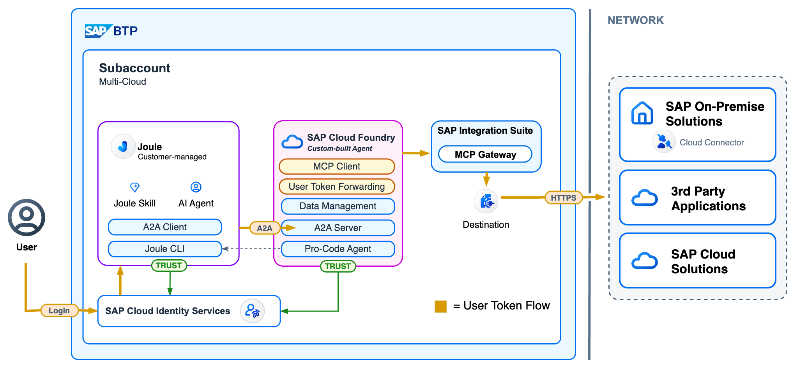

## Prerequisites

- A working A2A agent and destination setup, as described in the [principal propagation post](https://community.sap.com/t5/technology-blog-posts-by-sap/joule-a2a-propagate-the-user-identity-from-joule-into-s-4hana/ba-p/14420290)
- An S/4HANA Public Cloud system
- Integration Suite, Enhanced Edition (only that Edition contains the MCP Gateway)


## Step 1: Trust the Integration Suite subaccount in S/4

The very first step diverges from the previous post: the **trust setup**. Last time we configured S/4 to trust the destination certificate of the *agent's* subaccount. This time the piece that resolves the SAML Bearer assertion is the destination service of the subaccount where **Integration Suite** lives — and that is a different subaccount, with a different signing certificate (at least in my case). So we repeat the communication setup against that subaccount.

Concretely, in your Integration Suite subaccount go to **Connectivity → Destinations → Download Trust** and grab the `.pem`. It is a self-signed cert whose subject looks like `cfapps.<region>.hana.ondemand.com/<subaccount-id>` with `OU=CP Destination Configuration` — this is the destination-service signing certificate.

Then, exactly as in the [principal propagation post](https://community.sap.com/t5/technology-blog-posts-by-sap/joule-a2a-propagate-the-user-identity-from-joule-into-s-4hana/ba-p/14420290), set up a communication user, a communication system and a communication arrangement (`SAP_COM_0008` for Business Partner) in S/4 — but upload **this** certificate under the communication system's **OAuth 2.0 Identity Provider**, and copy its subject CN into the **Provider Name** field.

> **Note:** if the trust is missing or points at the wrong subaccount, the SAML exchange later fails with a very explicit *"There is no trust between entities … in client 100"*. That message contains the subaccount ID it actually saw, which makes it easy to tell that you trusted the wrong one.

## Step 2: Create the S/4HANA SAML Bearer destination in the IS subaccount

Next, create an HTTP destination toward S/4HANA **in the subaccount where Integration Suite resides**. This is the same `OAuth2SAMLBearerAssertion` destination as in the previous post — the MCP server will use it as its target. The important properties:

```
Name=S4_MCP_GATEWAY_TEST
Type=HTTP
ProxyType=Internet
Authentication=OAuth2SAMLBearerAssertion
URL=https://my3xxxxx-api.s4hana.cloud.sap
Audience=https://my3xxxxx.s4hana.cloud.sap
Token Service URL=https://my3xxxxx-api.s4hana.cloud.sap/sap/bc/sec/oauth2/token
Client Key / Token Service User=<the comm user from step 1>
authnContextClassRef=urn:oasis:names:tc:SAML:2.0:ac:classes:X509
userIdSource=mail
nameIdFormat=urn:oasis:names:tc:SAML:1.1:nameid-format:emailAddress

# additional properties
x_user_token.jwks_uri=https://<your-ias-tenant>/oauth2/certs
IntegrationCell.Include=true
```

Two things that are easy to miss:

- **`x_user_token.jwks_uri`** points at the IAS tenant so the destination service can validate the forwarded end-user token and build the SAML assertion for the real user. Without it, it silently falls back to a technical-user assertion and propagation breaks.
- **`IntegrationCell.Include=true`** is a label on the destination. Without it the destination simply won't appear in the MCP Server wizard's dropdown at all.

## Step 3: Build the MCP server in Integration Suite

Now the new part. In **Design → Integrations and APIs**, create an integration package to hold the artifact.

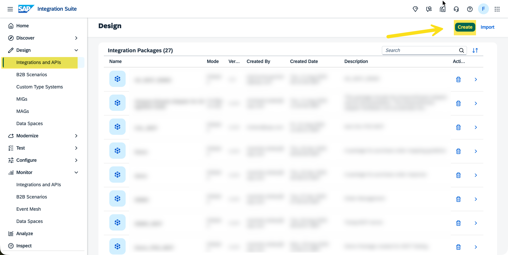

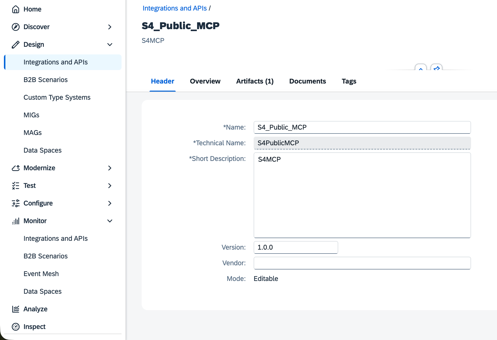

Inside the package, add an **MCP Server** artifact. The wizard's first step asks for the source type — pick **HTTP Endpoint with OpenAPI Specification**:

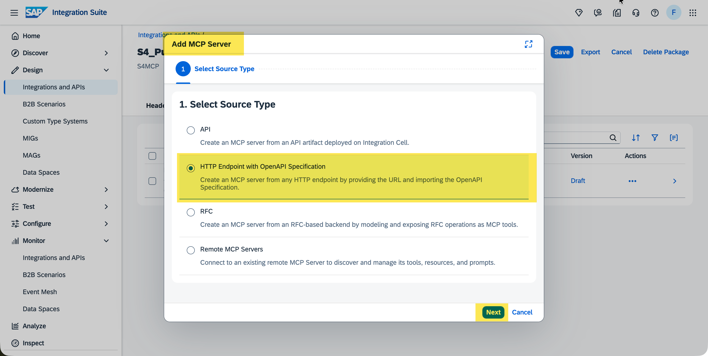

In the next step, point it at the `S4_MCP_GATEWAY_TEST` destination with a relative URL of `/sap/opu/odata/sap/API_BUSINESS_PARTNER`, give it a name and an MCP Path (e.g. `/s4_bp_mcp`), and leave the runtime profile on **Integration Cell**:

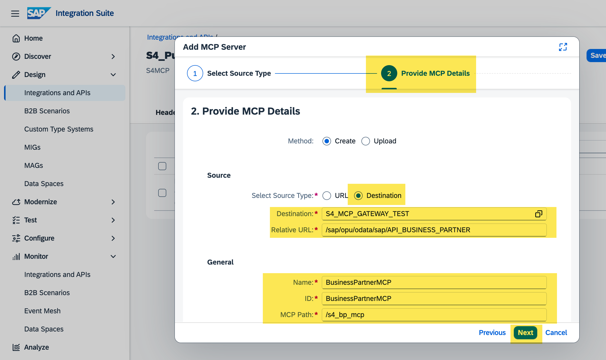

Skip the AI spec generation. Once the artifact exists, open its **MCP Configuration → Source** tab and hit **Edit API Specification** to supply the spec:

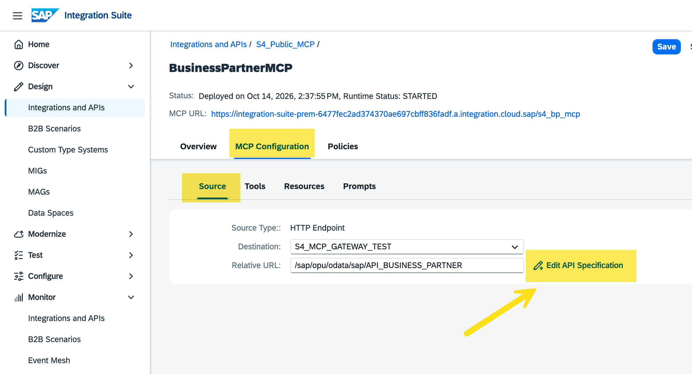

Import the OpenAPI/EDMX of the Business Partner service — you can download it from the [SAP Business Accelerator Hub](https://api.sap.com/api/API_BUSINESS_PARTNER/overview), or just pull the live `$metadata` from your own system:

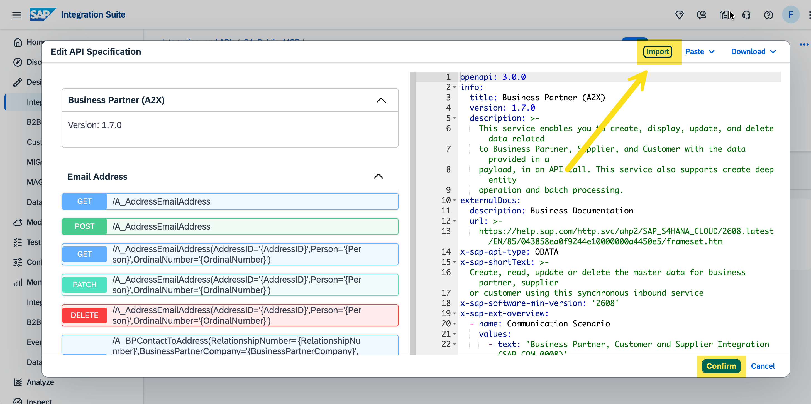

On the **Tools** tab, select the operations you want to expose; each one becomes an MCP tool. I started with a single `GET A_BusinessPartner` → the tool `get_A_BusinessPartner`. Keep it small; the model routes better with fewer, well-described tools:

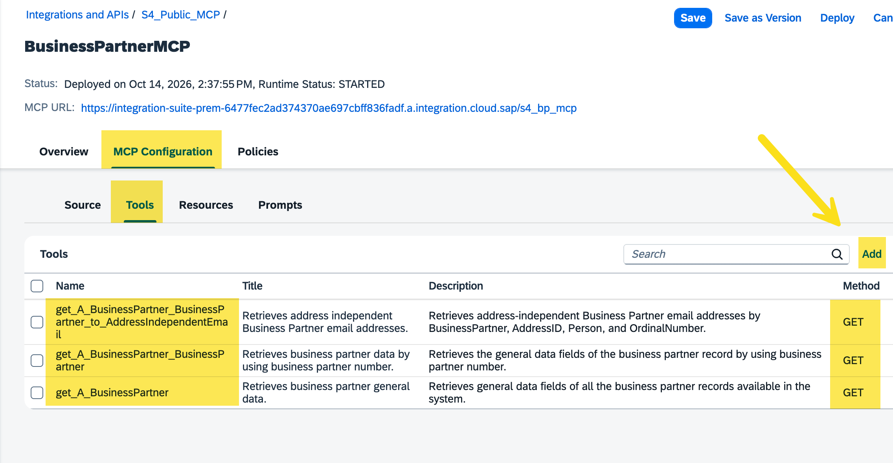

The tricky part is the inbound security — this is where the whole principal-propagation story lives. On the **Policies** tab every MCP server has a mandatory **Authentication** and **Authorization** policy, so we look at both.

### Authentication

The Authentication policy decides *which tokens the gateway trusts*. By default an MCP server validates tokens issued through the Integration Suite subaccount's own XSUAA / the IdP configured there. That default path is enough for a client like **Joule Work Desktop**, which runs its own user-token fetch flow against that trusted authorization server when you add the connector — so the end-user identity is already there, you don't configure anything extra on the gateway.

Our case is different: the token doesn't come from a JWD connector, it's the JWT our A2A agent forwards from Joule, issued by *our* IAS tenant — and a raw token from that issuer is rejected by the default policy with `401 invalidToken` because the gateway doesn't trust it yet.

The fix is to switch the Authentication policy to **External OAuth (OIDC)** and point it at our IAS tenant. Even though this feels a bit strange — our IAS tenant is treated as an "external" OAuth provider here — the "internal" option is the subaccount's XSUAA, which may well itself be configured to redirect logins to exactly that same IAS. So "external" just means: validate the token directly against the IAS tenant, by its own issuer and keys.

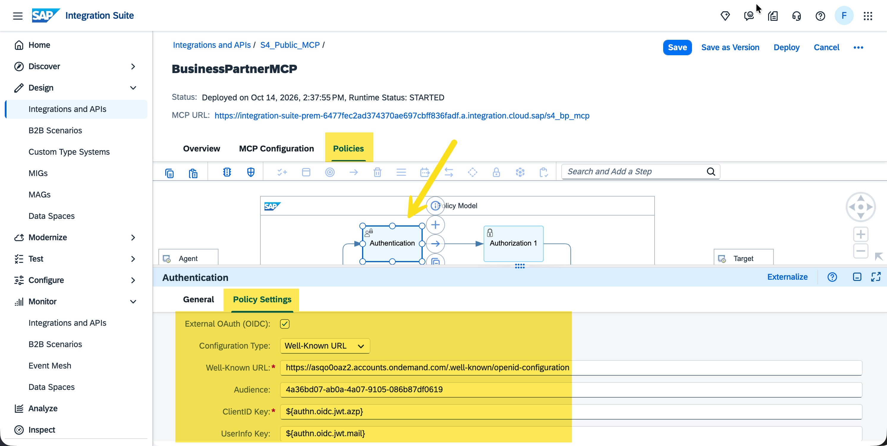

Once External OAuth is selected, there are four fields to fill:

| Field | Value |
|---|---|
| Well-Known URL | `https://<ias-tenant>/.well-known/openid-configuration` |
| Audience | the `aud` of the token the client actually sends (see the gotcha below) |
| ClientID Key | `${authn.oidc.jwt.azp}` |
| UserInfo Key | `${authn.oidc.jwt.mail}` |

What these actually do: the **Well-Known URL** tells the gateway *which* IAS tenant to trust — it discovers the issuer and the signing keys from there, and validates every incoming token's signature against them. The **Audience** is the gateway saying "I only accept tokens that were actually meant for this application" — it's matched against the token's `aud` claim. **ClientID Key** and **UserInfo Key** are expressions that tell the gateway which claims carry the calling client's ID (`azp`) and the end user's identity (`mail`) — the latter being exactly the identity that gets propagated downstream.

The **Audience** is the one that'll bite you. Our destination maps `userIdSource=mail`, and the token that eventually arrives is the one Joule *forwarded* — i.e. after its app-to-app exchange — so its `aud` is the **Custom Agent App** client ID, not the login app you used to get a test token. You find that client ID in your IAS admin console under **Applications → your Custom Agent App → Client ID** (it's the same value that your agent already validates as its `IAS_AUDIENCE`). If you set the policy audience to the wrong app, the real Joule token is rejected with `401 invalidToken` even though everything else is correct. You can also list multiple audiences comma-separated, or leave it empty to skip audience validation entirely while debugging.

If authentication is not configured correctly, the gateway rejects the call before it ever reaches your backend — a decoded IAS token that doesn't match issuer/audience comes back as:

```json
{ "error": { "code": "invalidToken", "message": "Unable to authenticate user, invalid token" } }
```
(HTTP 401)

### Authorization

The second mandatory policy is **Authorization** — and this is where it helps to understand how an IAS token is built, because it is fundamentally different from the XSUAA token you may be used to.

An XSUAA access token carries a `scope` claim (things like `myapp.Read`, `API.invoke`), and the default Authorization policy checks exactly that: *does the token contain the required scope?* An **IAS token has no `scope` claim at all.** IAS is an identity provider — it answers "who are you", not "what may you do"; the actual authorization is expected to happen in the target system (the user's S/4 roles, in our case). A decoded IAS user token has `mail`, `sub`, `azp` — but nothing a scope-based policy can match on.

What an IAS token *does* carry, because it came through Joule's app-to-app exchange, is the **`ias_apis`** claim — a **list** of the exposed APIs the user is allowed to call:

```json
{
  "iss": "https://<ias-tenant>",
  "aud": "<custom-agent-app client id>",
  "azp": "<proxy-app client id>",
  "mail": "felix.nachname@company.com",
  "ias_apis": ["a2a_custom_agent_app_api"]
}
```

So the configuration change versus the XSUAA default is: don't check a `scope` claim, check the `ias_apis` list instead. Point the Authorization policy's **Scope Key** at `ias_apis` and set the expected value to our exposed API:

| Authorization field | Value |
|---|---|
| Authorization Type | OAuth Scope OR Developer Key |
| Scope Key | `ias_apis` |
| Scope | `a2a_custom_agent_app_api` |

The policy then checks whether the `ias_apis` **list** contains `a2a_custom_agent_app_api` — which doubles as a useful access gate: it enforces, right at the gateway, that only users entitled to this agent's exposed API can call it at all.

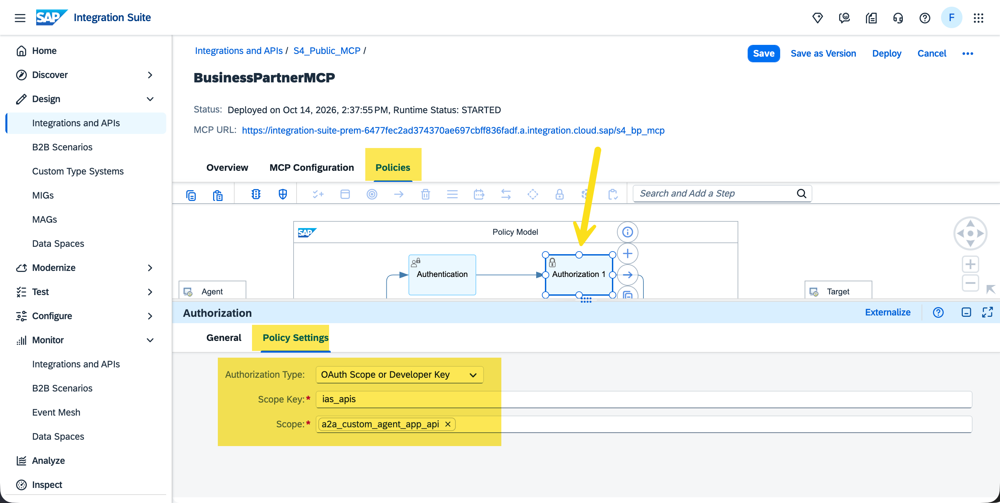

If authorization is wrong — e.g. the policy still checks `scope`, which an IAS token doesn't have — the gateway authenticates the user fine but then refuses the operation:

```json
{ "error": { "code": "forbidden", "message": "User doesn't have the authorization to perform this operation" } }
```
(HTTP 403)

With both policies right, the gateway accepts the real Joule user token, validates it against IAS, reads `mail`, and forwards the identity to the destination.

### Deploy MCP Server

Finally **Deploy** onto the Integration Cell runtime, and once the Runtime Status reads **STARTED** the MCP URL is live:

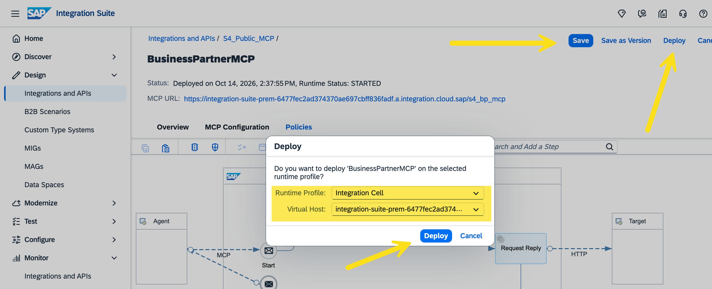

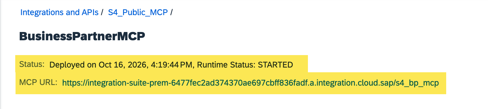

We've basically turned an OData endpoint into a proper MCP Server — with a curated list of tools — and put an auth layer in front of it that enforces principal propagation. Let's test it:

### Testing the gateway with curl

Before touching any agent code, it's worth proving the gateway end to end in isolation — exactly like the SAML dry-run in the previous post. MCP over Streamable HTTP is just JSON-RPC over HTTP, so three `curl` calls do it: `initialize` (which returns an `mcp-session-id` **response header** you must echo back), `notifications/initialized`, then `tools/call`.

```bash
# USER_JWT = a REAL Joule-forwarded token (see the caveat below), MCP_URL = the deployed MCP server URL

# 1) initialize — grab the mcp-session-id straight from the response header
SID=$(curl -s -o /dev/null -w '%header{mcp-session-id}' -X POST "$MCP_URL" \
  -H "Authorization: Bearer $USER_JWT" \
  -H "Accept: application/json, text/event-stream" \
  -d '{"jsonrpc":"2.0","id":1,"method":"initialize","params":{"protocolVersion":"2025-06-18","capabilities":{},"clientInfo":{"name":"curl","version":"1.0"}}}')

# 2) say "initialized"
curl -s -o /dev/null -X POST "$MCP_URL" -H "Authorization: Bearer $USER_JWT" \
  -H "Accept: application/json, text/event-stream" -H "mcp-session-id: $SID" \
  -d '{"jsonrpc":"2.0","method":"notifications/initialized"}'

# 3) call the tool as the user (note: OData options without `$`, select is an ARRAY)
curl -s -X POST "$MCP_URL" -H "Authorization: Bearer $USER_JWT" \
  -H "Accept: application/json, text/event-stream" -H "mcp-session-id: $SID" \
  -d '{"jsonrpc":"2.0","id":2,"method":"tools/call","params":{"name":"get_A_BusinessPartner","arguments":{"top":3,"select":["BusinessPartner","BusinessPartnerName"]}}}'
```

This is the fastest feedback loop for getting the two policies right — the error you get back tells you exactly which stage failed: `401 invalidToken` = authentication (issuer/audience), `403 forbidden` = authorization (scope/`ias_apis`), real OData rows = success.

> **Getting a token that actually works for the test.** A plain IAS `password` grant gives you a token audienced for the *login* app and **without** `ias_apis`, so it fails both audience and authorization — it is not a stand-in for what Joule sends. You have two options to get a realistic token:
>
> 1. **Reproduce the app-to-app exchange yourself.** This is exactly what Joule does internally: take the user token and exchange it (via the `jwt-bearer` grant against your IAS, using the proxy app's client credentials and the `proxy-to-target` dependency) into a token audienced for the Custom Agent App — which then carries `ias_apis`. If you own the proxy app's credentials, this is the clean, scriptable way and the one I'd recommend for a proper test harness.
> 2. **Capture a real one.** Quicker for a one-off: temporarily log the raw `Authorization` header in your agent, prompt Joule once, and copy the forwarded JWT out of the logs.

## Step 4: The Python agent that calls the MCP gateway

The change on the agent side is small and local: the one place that used to call the destination service and S/4 directly (`s4_client.py` in the previous post) is replaced by a small **MCP client**. Everything else — the LangGraph tool, the executor, the IAS middleware on the agent's own inbound endpoint — stays as it was.

The MCP client uses Streamable-HTTP JSON-RPC to call the MCP Gateway. This is part of the standard of MCP - and one could also use a SDK. We do 3 calls: `initialize` (which hands back an `mcp-session-id` response header you carry on every following request), `notifications/initialized`, and `tools/call`:

```python
# mcp_client.py (abridged)
def call_business_partner_api(user_jwt, top=10, select=None, filter_expr=None, ...):
    session_id = _open_session(user_jwt)        # initialize -> mcp-session-id
    r = requests.post(
        MCP_URL,
        headers={
            "Authorization": f"Bearer {user_jwt}",   # <-- the whole trick
            "Accept": "application/json, text/event-stream",
            "mcp-session-id": session_id,
        },
        json={
            "jsonrpc": "2.0", "id": 2, "method": "tools/call",
            "params": {
                "name": "get_A_BusinessPartner",
                "arguments": {"top": top, "select": [...]},   # OData options, no `$`, select is an array
            },
        },
    )
    # tool output comes back as result.content[0].text (JSON string of the OData payload)
```

The `user_jwt` it forwards is the exact same token the agent already extracts from the inbound A2A request — unchanged from the previous post:

```python
# agent_executor.py — the token comes straight from the Authorization header Joule sent
auth = context._call_context.state.get("headers", {}).get("authorization", "")
user_jwt = auth[len("bearer "):] if auth.lower().startswith("bearer ") else None
# ... threaded down to the tool, which puts it on the MCP call as Authorization: Bearer
```

The key point: the agent needs **no credentials of its own** for the backend. No client secret, no destination binding to S/4 — just the `MCP_URL` of the deployed gateway. It takes the user's token and passes it on; IAS, the gateway and the destination service do the rest. (The agent's *own* inbound A2A endpoint is still protected by the IAS middleware exactly as before.)

Two details are worth knowing when calling an Integration-Suite-generated tool: the handshake is **session-based** (echo the `mcp-session-id` header after `initialize`), and the generated tool schema uses OData options **without** the leading `$`, with `select`/`expand`/`orderby` as **arrays of strings** — pass a comma-separated string and the call fails schema validation.

## Test in Joule

Deploy the agent, point Joule's agent destination at it, and prompt it — e.g. *"show me business partners that start with I"*. The full chain runs: the agent forwards the user's token to the gateway, the gateway validates it against IAS, propagates the signed-in user through the SAML Bearer destination, and S/4HANA returns exactly the records that user is authorized to see, rendered as a table in the conversation:

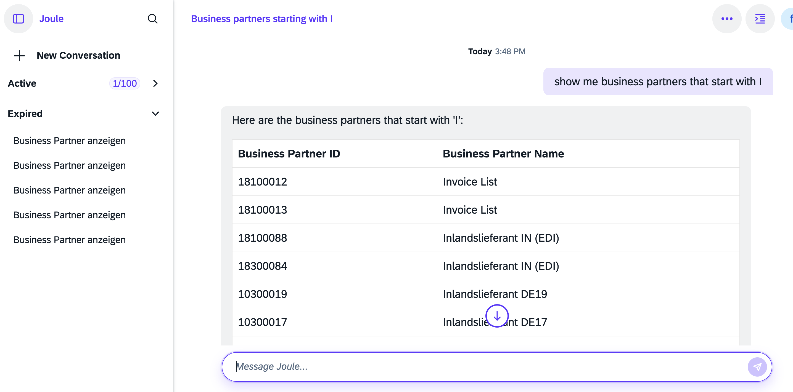

This is the point of the whole exercise: the data comes back scoped to the real signed-in user, propagated all the way from Joule to S/4HANA — exactly the behaviour we wanted. And because it now runs through the gateway, we can also *see* it happen: in Integration Suite under **Monitor → Integrations and APIs → Monitor Message Processing** (with the Integration Cell runtime selected), each prompt shows up as a `BusinessPartnerMCP` entry of type *MCP Server*, status *Completed*. That's the proof the call actually traversed the MCP gateway rather than some direct backchannel — and the governance, tracing and policy enforcement that come with it apply to every call.

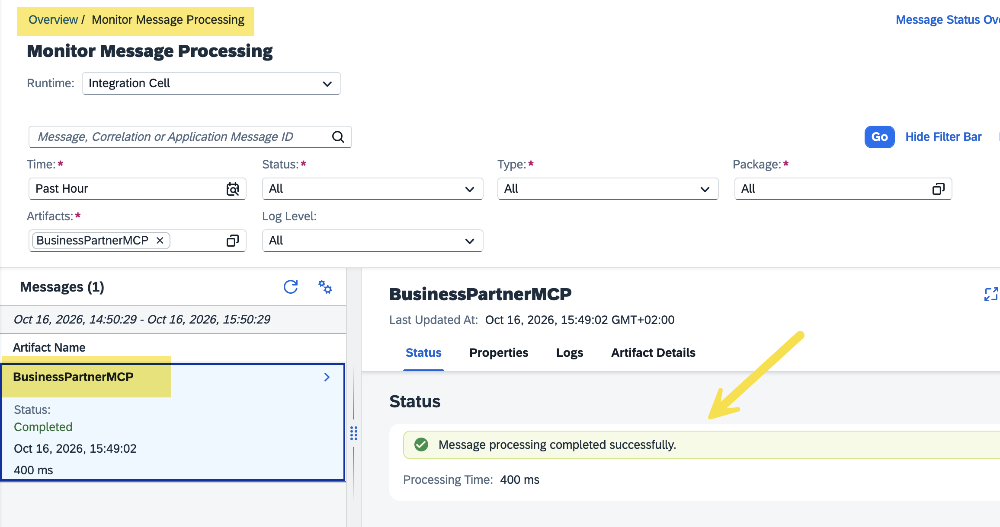

## Conclusion

Looks good. We have the full flow in place and can use the MCP Gateway for our A2A Agents. Hope you found this insightful.

The full code is on [GitHub](https://github.com/fyx99/joule-pro-code-a2a) under `a2a_pp_mcp_gateway/`.

This post is part of the **Joule A2A** series:

- [Connect code-based agents into Joule](https://community.sap.com/t5/technology-blog-posts-by-sap/joule-a2a-connect-code-based-agents-into-joule/ba-p/14329279)
- [Secure code-based agents with IAS](https://community.sap.com/t5/technology-blog-posts-by-sap/joule-a2a-secure-code-based-agents-with-ias/ba-p/14367792)
- [Handling multi-turn conversations](https://community.sap.com/t5/technology-blog-posts-by-sap/joule-a2a-handeling-multi-turn-conversations/ba-p/14377615)
- [Building custom Joule capabilities: message types in practice](https://community.sap.com/t5/technology-blog-posts-by-sap/building-custom-joule-capabilities-message-types-in-practice/ba-p/14406014)
- [Propagate the user identity from Joule into S/4HANA](https://community.sap.com/t5/technology-blog-posts-by-sap/joule-a2a-propagate-the-user-identity-from-joule-into-s-4hana/ba-p/14420290)
- **MCP Gateway to S/4HANA with Principal Propagation** (this post)